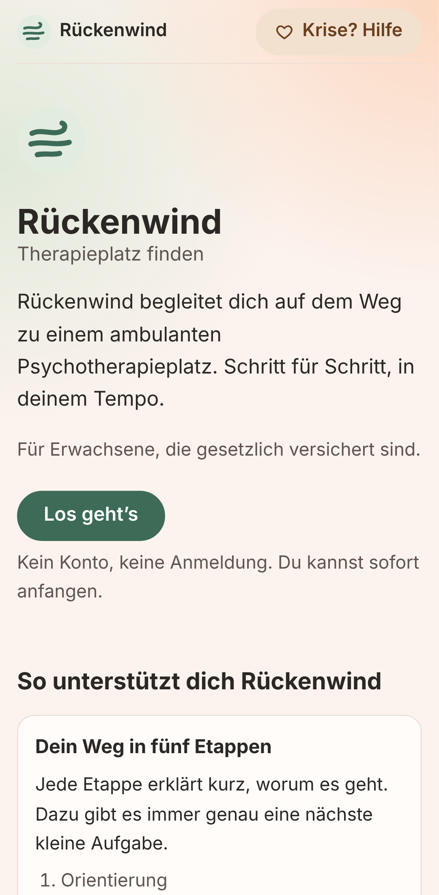
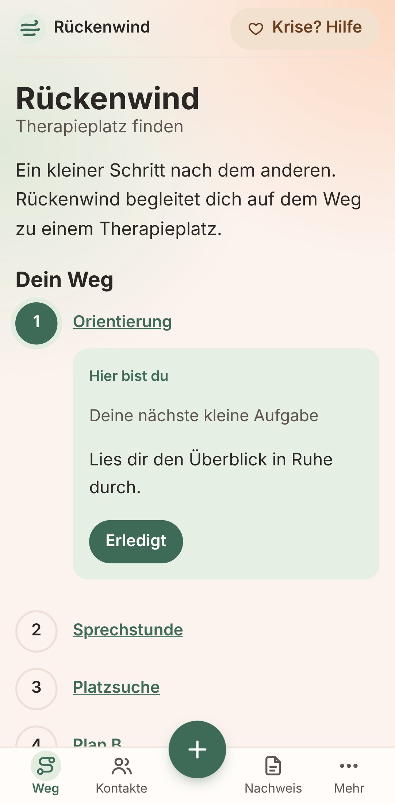
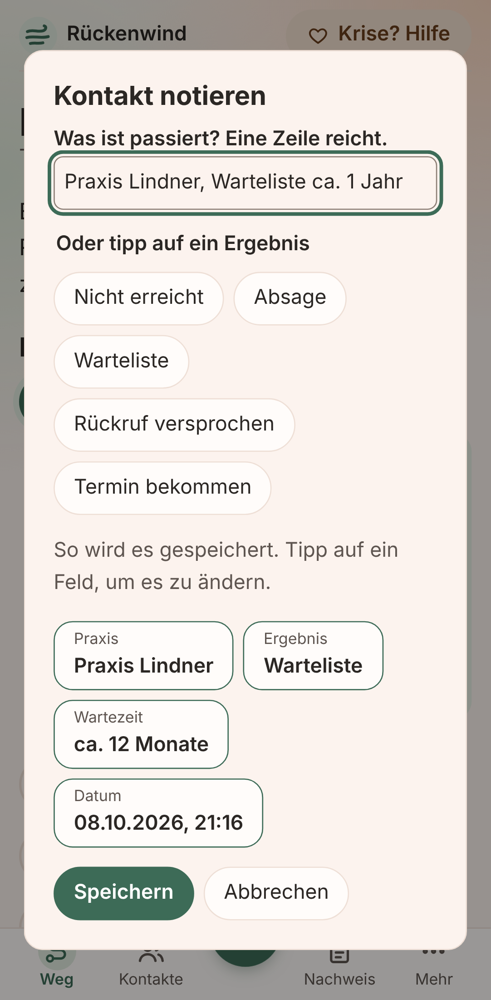
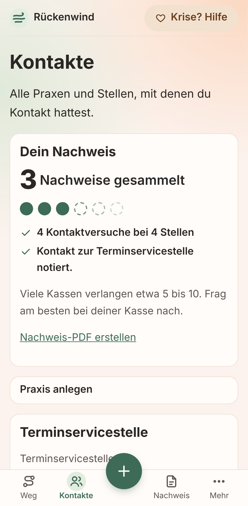
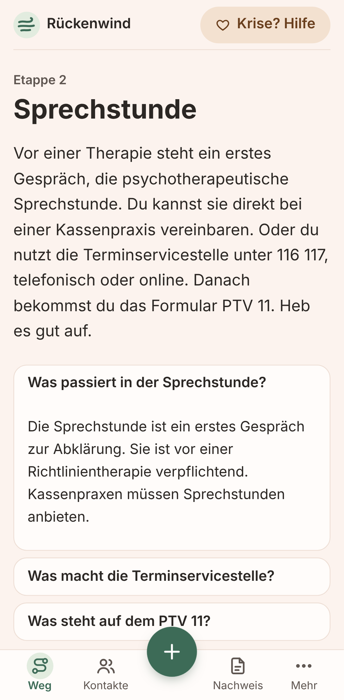
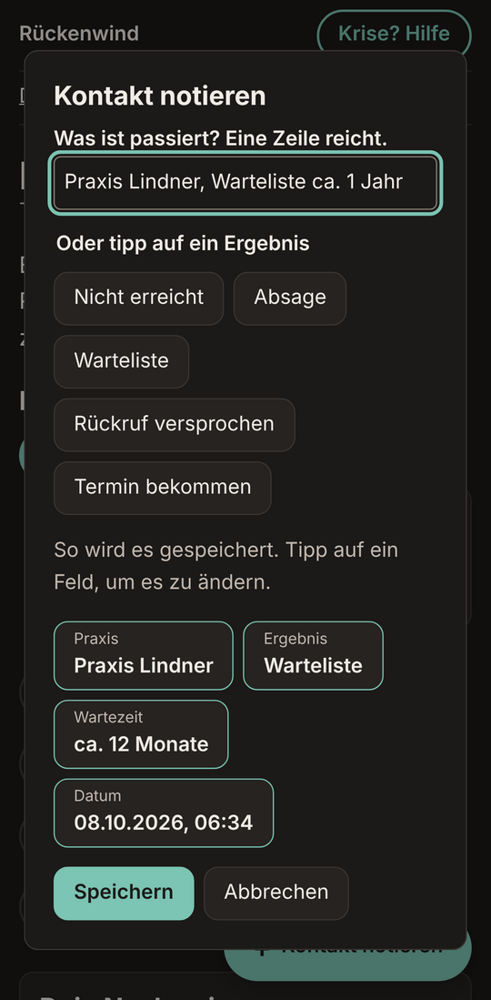

# Rückenwind – Therapieplatz finden

[](https://github.com/sebiweise/rueckenwind/actions/workflows/pages.yml)
[](https://github.com/sebiweise/rueckenwind/actions/workflows/security.yml)
[](https://sonarcloud.io/summary/new_code?id=sebiweise_rueckenwind)
[](LICENSE)
[](content/LICENSE)

Rückenwind ist eine Open-Source-Web-App (PWA), die gesetzlich Versicherte in Deutschland auf dem Weg zu einem ambulanten Psychotherapieplatz begleitet. Sie erklärt die Schritte verständlich, schlägt immer genau eine nächste kleine Aufgabe vor und dokumentiert jeden Kontaktversuch nebenbei. Am Ende entsteht daraus ein Nachweis-PDF für das Kostenerstattungsverfahren.

**Ausprobieren:** <https://sebiweise.github.io/rueckenwind/> (läuft komplett im Browser, deine Daten bleiben auf deinem Gerät).

> **Status:** MVP fertig, Version 0.1.0 in Vorbereitung. Die Infotexte werden vor dem ersten Release noch fachkundig geprüft.

> **Akute Krise?** Warte nicht auf einen Therapieplatz. Notruf **112**, Telefonseelsorge **0800 111 0 111** oder **0800 111 0 222** (kostenfrei, rund um die Uhr, auch Chat auf [telefonseelsorge.de](https://www.telefonseelsorge.de)) oder die psychiatrische Notaufnahme einer Klinik in deiner Nähe.

## Warum

Wer keinen Kassenplatz findet, ruft viele Praxen an, oft nur in kurzen Telefonsprechzeiten. Für die Kostenerstattung verlangen Kassen eine Liste erfolgloser Anfragen. Das ist anstrengend, gerade in einer belastenden Lage. Rückenwind soll die Suche leichter machen: Jeder Anruf, auch eine Absage, zählt sichtbar als Fortschritt.

## Screenshots

| Einführung                                                                  | Dein Weg                                                                               | Kontakt notieren                                                           | Kontakte                                                                          | Etappe                                                                                   |
| --------------------------------------------------------------------------- | -------------------------------------------------------------------------------------- | -------------------------------------------------------------------------- | --------------------------------------------------------------------------------- | ---------------------------------------------------------------------------------------- |
|  |  |  |  |  |

Dunkelmodus: 

Screenshots neu erzeugen: Server starten (`npm start` mit `PORT=4173`), dann `node scripts/screenshots.mjs`. Alle Daten darin sind erfunden.

## Was die App kann

- **Kurze Einführung:** Die Startseite (`/`) erklärt die Idee und wie du anfängst. Die App selbst liegt unter `/app/`; die installierte App startet direkt dort.
- **Dein Weg:** oben immer genau ein nächster kleiner Schritt, darunter die fünf Etappen als Weg mit sichtbarem Fortschritt. Eine fertige Etappe bekommt einen ruhigen Erfolgsmoment.
- **Kontakt in einer Zeile notieren:** „Praxis Weber, AB, Warteliste 8 Monate“ wird lokal erkannt und als Vorschau gezeigt. Korrigieren per Tipp, speichern mit einem Tipp. Dazu Schnellbuttons.
- **Kontakte und Fortschritt:** alle Praxen mit letztem Stand, Telefonzeiten und Verlauf. Absagen zählen sichtbar als gesammelte Nachweise.
- **Nachweis-PDF:** eine Liste aller Anfragen für den Antrag auf Kostenerstattung, erzeugt im Browser.
- **Sichern, wiederherstellen, löschen:** als JSON-Datei, ohne Konto.
- **Offline nutzbar und installierbar** (PWA), hell und dunkel, drei Farbthemen zur Wahl (Salbei, Pfirsich, Himmel), barrierearm (WCAG 2.2 AA als Ziel).
- **Krisenhilfe** auf jeder Seite erreichbar.

## Datenschutz-Versprechen

- **Deine Daten bleiben auf deinem Gerät.** Alles wird nur im Browser gespeichert (IndexedDB).
- **Kein Konto, kein Server für deine Daten, kein Tracking.** Keine Analytics, keine externen Fonts, keine CDNs.
- **Keine Verbindungen nach außen, außer du schickst selbst Feedback.** Eine Content-Security-Policy erlaubt nur Anfragen an die eigene Seite und an den Feedback-Dienst (siehe [Feedback](#feedback)). Inline-Skripte sind nur mit ihrem Hash erlaubt (beim Build berechnet). Automatische Tests prüfen das.
- **Sicherung nur per Datei.** Du kannst deine Daten als JSON exportieren, wieder importieren und jederzeit vollständig löschen.

## Feedback

Unter `/feedback/` (verlinkt unter „Mehr“ und im Fuß jeder Seite) gibt es ein freiwilliges Formular für Fehler, Wünsche und Sonstiges. Gesendet wird nur, was dort eingetippt wird: die Art, der Text und auf Wunsch eine E-Mail-Adresse für eine Antwort. Nichts aus den gespeicherten Einträgen, keine Diagnosedaten, keine Cookies, kein Referrer. Offline sagt das Formular das, statt still zu scheitern; der Text bleibt dann stehen.

- **Weg:** `POST <NEXT_PUBLIC_FEEDBACK_URL>/v1/feedback/rueckenwind` an einen zentralen Feedback-Dienst (Cloudflare Worker, USA, EU-US Data Privacy Framework). Er legt daraus ein Issue in einem privaten GitHub-Repository an (USA, EU-US DPF). Die IP-Adresse nutzt er nur kurz für ein Rate Limit, gespeichert wird sie nicht. Die Über-Seite (`content/de/ueber.md`) beschreibt das für Nutzer.
- **Konfiguration:** `NEXT_PUBLIC_FEEDBACK_URL` beim Build, Standard `https://feedback.sebiweise.workers.dev`. Derselbe Wert landet in `connect-src` der CSP (`src/lib/config.ts`, `src/lib/csp.ts`, `scripts/postbuild.mjs`). Leer gesetzt (`NEXT_PUBLIC_FEEDBACK_URL=`) gibt es kein Formular, keine Links dorthin und keine fremde Origin in der CSP, etwa für eine selbst gehostete Instanz.
- **Ein eigener Host** braucht beim Feedback-Dienst einen freigegebenen Origin. Die offizielle Version ist nur für `https://sebiweise.github.io` freigegeben; von anderen Origins antwortet der Dienst mit 403.
- **Tests:** `src/lib/feedback.spec.ts` (Body, Fehler, offline) und `e2e/feedback.e2e.ts` (mit einem Mock des Dienstes, ohne echte Anfragen).

## Hinweis

Rückenwind informiert und hilft beim Organisieren. Die App ist **keine Rechts- oder Medizinberatung**, stellt keine Diagnosen und gibt keine Garantie, dass ein Antrag bewilligt wird. Die Infotexte werden vor dem ersten Release fachkundig geprüft.

## Entwicklung

Voraussetzung: Node.js 22.18 oder neuer (siehe `.nvmrc`).

```sh
npm ci              # Abhängigkeiten installieren
npm run dev         # Entwicklungsserver
npm run lint        # Prettier + ESLint
npm run check       # Typprüfung (tsc)
npm test            # Unit-Tests (Vitest)
npm run test:coverage   # Unit-Tests mit Abdeckung (Domäne ≥ 90 %)
npm run test:e2e    # E2E-Tests (Playwright + axe-core); vorher einmal: npx playwright install chromium
                    # oder vorhandenes Chromium nutzen: PLAYWRIGHT_CHROMIUM_PATH=/pfad/zu/chrome
npm run build       # Produktions-Build (statischer Export nach out/)
npm start           # Build lokal ausliefern (http://localhost:4173)

# wie auf GitHub Pages, unter dem Unterpfad /rueckenwind (so prüft es auch CI):
BASE_PATH=/rueckenwind npm run build
BASE_PATH=/rueckenwind npm start   # http://localhost:4173/rueckenwind/
BASE_PATH=/rueckenwind npm run test:e2e
```

Tech-Stack: Next.js + React + TypeScript, Plain CSS, Vitest, Playwright. Details, Datenmodell und Phasen stehen im [Umsetzungsplan](docs/PLAN.md), das Fachwissen in [docs/WISSEN.md](docs/WISSEN.md).

### Projektstruktur

```
content/de/          Infotexte als Markdown (CC BY-SA 4.0)
docs/                Plan und Wissensstand
e2e/                 End-to-End-Tests
src/app/             Seiten und Layout
src/components/      UI-Komponenten
src/lib/domain/      reine Logik ohne Framework (Parser, Etappen, Fortschritt)
src/lib/data/        lokale Datenhaltung, Export/Import
src/lib/i18n/        UI-Texte
```

## Hosting

Rückenwind braucht kein eigenes Backend. Der Build ist eine rein statische Seite, deine Daten bleiben im Browser. Nur das freiwillige Feedback geht an einen externen Dienst (siehe [Feedback](#feedback)).

**GitHub Pages** (so läuft die offizielle Version unter <https://sebiweise.github.io/rueckenwind/>): Der Workflow [`pages.yml`](.github/workflows/pages.yml) baut bei jedem Push auf `master` den statischen Export mit `BASE_PATH=/<Repository-Name>` und veröffentlicht ihn. In einem Fork unter Settings → Pages als Source „GitHub Actions“ wählen.

**Jeder andere statische Host** (Netlify, ein einfacher Webserver):

```sh
npm ci && npm run build                          # App im Wurzelverzeichnis der Domain, nach out/
npm ci && BASE_PATH=/rueckenwind npm run build   # App unter einem Unterpfad wie /rueckenwind
```

Nach dem Build läuft `scripts/postbuild.mjs`: Es fügt in jede Seite eine CSP ein, die Inline-Skripte nur per Hash erlaubt, und baut den Service Worker (`sw.js`, Serwist) für die Offline-Nutzung. Wer selbst hostet und ein Impressum braucht, legt `content/de/impressum.md` an; es erscheint dann auf der Über-Seite.

**Sicherheits-Header:** Ein statischer Host wie GitHub Pages kann keine eigenen HTTP-Header senden. Die Content-Security-Policy und die Referrer-Policy (`no-referrer`) stecken deshalb als Meta-Tags in jeder Seite. Was per Meta-Tag nicht geht und auf GitHub Pages fehlt: Schutz vor dem Einbetten in fremde Seiten (`X-Frame-Options: DENY` bzw. `frame-ancestors`), `X-Content-Type-Options: nosniff` und `Permissions-Policy`. Wenn dein Host Header setzen kann, ergänze diese:

```text
X-Frame-Options: DENY
X-Content-Type-Options: nosniff
Permissions-Policy: camera=(), microphone=(), geolocation=(), interest-cohort=()
```

## Mitmachen

Die Infotexte liegen als Markdown in [`content/de/`](content/de/README.md). Korrekturen daran sind besonders willkommen, auch ohne Programmierkenntnisse. Wie das geht, steht in [CONTRIBUTING.md](CONTRIBUTING.md). Bitte beachte den [Verhaltenskodex](CODE_OF_CONDUCT.md).

## Lizenz

- Code: [MIT](LICENSE)
- Inhalte in `content/`: [CC BY-SA 4.0](content/LICENSE)
